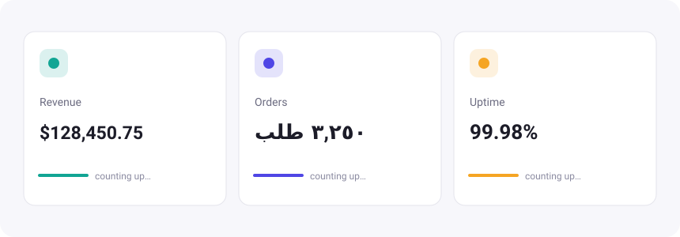

# animated_counter_text

[](https://pub.dev/packages/animated_counter_text)
[](https://github.com/senkop/animated_counter_text/actions/workflows/ci.yml)
[](LICENSE)

A number that counts smoothly to its new value. Great for dashboards, totals and stats. No dependencies.

- Counts up on first show, then animates between values
- Decimals, thousands separators, prefix and suffix
- Arabic-Indic digits: ١٢٨,٤٥٠
- Tabular figures so the text does not jitter
- `formatCounterNumber` helper for formatting without animation



## Install

```bash
flutter pub add animated_counter_text
```

## Usage

```dart
import 'package:animated_counter_text/animated_counter_text.dart';

AnimatedCounterText(value: total, prefix: r'$', decimals: 2)

AnimatedCounterText(
  value: orders,
  suffix: ' طلب',
  arabicDigits: true,
  style: Theme.of(context).textTheme.displaySmall,
)
```

## Example

```bash
cd example
flutter create .
flutter run -d chrome
```

## License

MIT
